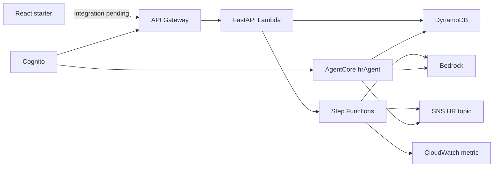
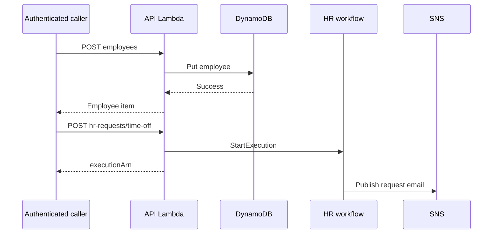

## Architecture Analysis

### System Overview
Serverless Python CDK application: Cognito authorizes API Gateway calls to a FastAPI/Mangum Lambda; DynamoDB persists employees and leave. Step Functions handles HR requests through Bedrock/SNS/CloudWatch. A separate Cognito-authorized AgentCore runtime hosts a Strands agent sharing the table and topic.

### Architectural Style
Controllers call service modules that perform boto3 operations. CDK separates backend, notifications, workflow, and runtime stacks. UI is an unconnected React SPA starter. Alternate AgentCore CLI TypeScript deployment configuration also exists; root app.py uses Python AgentRuntimeStack.

### Component Relationships

<!-- Text fallback: Cognito protects the API and agent. Lambda uses DynamoDB and starts workflows; workflows invoke Bedrock and SNS. The agent shares DynamoDB, SNS, and Bedrock. UI integration is pending. -->

### Data Flow
Employee items use PK USER, SK employee ID, GSI1PK USER_BY_DATE, GSI1SK hire date. Leave uses PK employee ID and SK start date. HR requests return executionArn immediately, with no result polling API. Runtime parses prompt/messages, scopes an agent by session and actor, then yields model/tool event dictionaries.

### Key Design Decisions
Root app reuses backend references across stacks. Layer and agent image references resolve via SSM parameters. Cognito self signup is disabled; existing client permits password and SRP auth. Root runtime config uses Cognito; generated alternate config has a distinct deployment lifecycle.

### Improvement Opportunities
Register leave routes if required by UI, remove duplicate routing carefully, provide UI configuration, preserve resource identities, and test boundaries. Current API authentication is gateway-level, without per-user/role authorization.

## Interaction Diagrams

<!-- Text fallback: Employee creation writes DynamoDB synchronously. Time-off submission returns a workflow execution ID, then the workflow publishes an HR notification. -->

